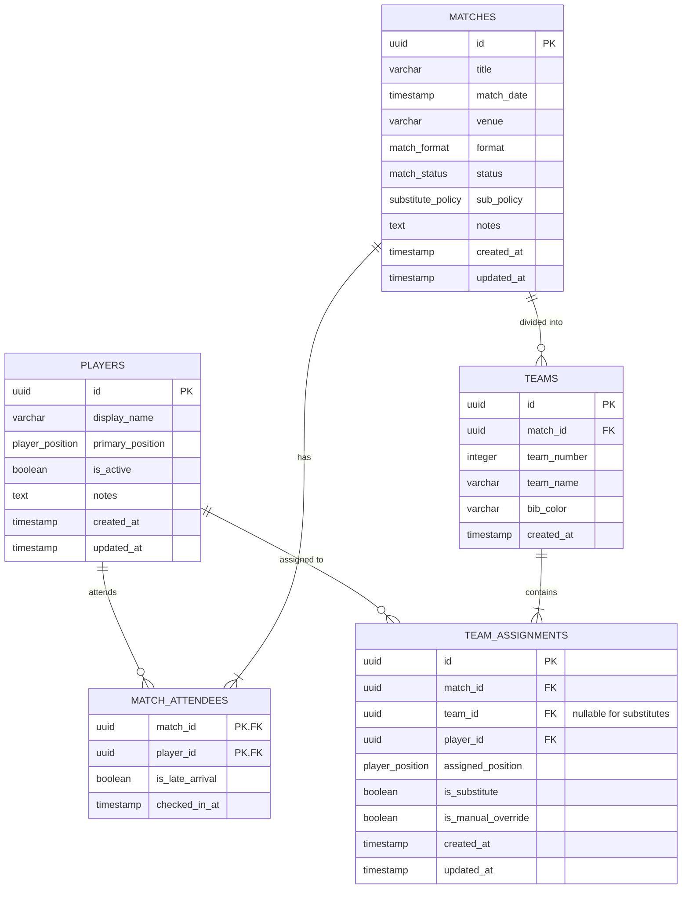

# F4F Application — Database Design & Schema

## 1. Schema Design Principles

1. **Relational Integrity:** A player must never be assigned to more than one team in the same match. Foreign key constraints and database-level unique constraints enforce this at the persistence layer.
2. **Deterministic Enums:** Standardize positions, match formats, and match statuses using PostgreSQL native enum types to reject invalid strings at the database boundary.
3. **Auditability & Stability:** Every primary key uses universally unique identifiers (`UUIDv4`) to prevent ID collision and avoid exposing sequential counts. Every table records `created_at` and `updated_at` timestamps in UTC.
4. **Soft Deactivation:** Players are deactivated (`is_active = FALSE`) rather than hard-deleted to preserve historical match records.

---

## 2. Entity-Relationship Model



---

## 3. PostgreSQL DDL (Data Definition Language)

```sql
-- Extensions
CREATE EXTENSION IF NOT EXISTS "uuid-ossp";

-- 1. Enums
CREATE TYPE player_position AS ENUM (
    'KEEPER',
    'DEFENDER',
    'MIDFIELDER',
    'STRIKER'
);

CREATE TYPE match_format AS ENUM (
    'SIX_A_SIDE',
    'SEVEN_A_SIDE',
    'NINE_A_SIDE'
);

CREATE TYPE match_status AS ENUM (
    'DRAFT',                -- Match created, attendance open
    'ATTENDANCE_LOCKED',    -- Attendees confirmed
    'TEAMS_GENERATED',      -- Teams produced by engine
    'FINALISED',            -- Review complete, exported to WhatsApp
    'COMPLETED',            -- Match played
    'CANCELLED'             -- Session called off
);

CREATE TYPE substitute_policy AS ENUM (
    'STRICT_SUBSTITUTES',   -- Keep exact team sizes, remainder are substitutes
    'DISTRIBUTE_ALL'        -- Expand team sizes to fit everyone evenly
);

-- 2. Players Table
CREATE TABLE players (
    id UUID PRIMARY KEY DEFAULT uuid_generate_v4(),
    display_name VARCHAR(100) NOT NULL,
    primary_position player_position NOT NULL,
    is_active BOOLEAN NOT NULL DEFAULT TRUE,
    notes TEXT,
    created_at TIMESTAMPTZ NOT NULL DEFAULT CURRENT_TIMESTAMP,
    updated_at TIMESTAMPTZ NOT NULL DEFAULT CURRENT_TIMESTAMP
);

CREATE INDEX idx_players_active_position ON players (is_active, primary_position);
CREATE INDEX idx_players_display_name ON players (display_name);

-- 3. Matches Table
CREATE TABLE matches (
    id UUID PRIMARY KEY DEFAULT uuid_generate_v4(),
    title VARCHAR(150),
    match_date TIMESTAMPTZ,
    venue VARCHAR(150),
    format match_format NOT NULL DEFAULT 'SEVEN_A_SIDE',
    status match_status NOT NULL DEFAULT 'DRAFT',
    sub_policy substitute_policy NOT NULL DEFAULT 'STRICT_SUBSTITUTES',
    notes TEXT,
    created_at TIMESTAMPTZ NOT NULL DEFAULT CURRENT_TIMESTAMP,
    updated_at TIMESTAMPTZ NOT NULL DEFAULT CURRENT_TIMESTAMP
);

CREATE INDEX idx_matches_date_status ON matches (match_date, status);

-- 4. Match Attendees Table
CREATE TABLE match_attendees (
    match_id UUID NOT NULL REFERENCES matches(id) ON DELETE CASCADE,
    player_id UUID NOT NULL REFERENCES players(id) ON DELETE RESTRICT,
    is_late_arrival BOOLEAN NOT NULL DEFAULT FALSE,
    checked_in_at TIMESTAMPTZ NOT NULL DEFAULT CURRENT_TIMESTAMP,
    PRIMARY KEY (match_id, player_id)
);

CREATE INDEX idx_match_attendees_player ON match_attendees (player_id);

-- 5. Teams Table
CREATE TABLE teams (
    id UUID PRIMARY KEY DEFAULT uuid_generate_v4(),
    match_id UUID NOT NULL REFERENCES matches(id) ON DELETE CASCADE,
    team_number INT NOT NULL,
    team_name VARCHAR(50) NOT NULL,
    bib_color VARCHAR(30),
    created_at TIMESTAMPTZ NOT NULL DEFAULT CURRENT_TIMESTAMP,
    CONSTRAINT uq_match_team_number UNIQUE (match_id, team_number)
);

CREATE INDEX idx_teams_match ON teams (match_id);

-- 6. Team Assignments Table
CREATE TABLE team_assignments (
    id UUID PRIMARY KEY DEFAULT uuid_generate_v4(),
    match_id UUID NOT NULL REFERENCES matches(id) ON DELETE CASCADE,
    team_id UUID REFERENCES teams(id) ON DELETE CASCADE, -- NULL if substitute
    player_id UUID NOT NULL REFERENCES players(id) ON DELETE RESTRICT,
    assigned_position player_position NOT NULL,
    is_substitute BOOLEAN NOT NULL DEFAULT FALSE,
    is_manual_override BOOLEAN NOT NULL DEFAULT FALSE,
    created_at TIMESTAMPTZ NOT NULL DEFAULT CURRENT_TIMESTAMP,
    updated_at TIMESTAMPTZ NOT NULL DEFAULT CURRENT_TIMESTAMP,
    -- Enforce that a player can only appear ONCE in any match (assigned or sub)
    CONSTRAINT uq_match_player_assignment UNIQUE (match_id, player_id)
);

CREATE INDEX idx_assignments_team ON team_assignments (team_id);
CREATE INDEX idx_assignments_match_sub ON team_assignments (match_id, is_substitute);
```

---

## 4. Migration Strategy

We will use standard versioned SQL migrations using `golang-migrate` (CLI or Go library embed):
- Every migration consists of two files:
  - `000001_create_players_table.up.sql`
  - `000001_create_players_table.down.sql`
- Migrations are committed to Git under `backend/migrations/`.
- During application startup (`main.go`), an automatic migration runner verifies and applies pending migrations before starting the HTTP listener.
- This ensures reproducible deployments on local developer machines, CI pipelines, and production servers.

---

## 5. Seed Roster Data (42 Corrected Players)

A dedicated database seed script (`backend/cmd/seed/main.go` and `backend/migrations/000004_seed_roster.up.sql`) seeds the initial 42 unique players with normalised positions:

```sql
INSERT INTO players (display_name, primary_position) VALUES
('Lenpu', 'KEEPER'),
('Joseph', 'STRIKER'),
('Savio', 'STRIKER'),
('Zamsei', 'MIDFIELDER'),
('Thonglam', 'DEFENDER'),
('Robert', 'DEFENDER'),
('Mimin Baite', 'DEFENDER'),
('Lalboi', 'STRIKER'),
('Eric', 'MIDFIELDER'),
('Seiminthang', 'DEFENDER'),
('Joshua', 'MIDFIELDER'),
('Lalchaneo', 'DEFENDER'),
('Mimin Touthang', 'MIDFIELDER'),
('Paokai', 'MIDFIELDER'),
('Johny', 'DEFENDER'),
('Paolal', 'DEFENDER'),
('Haopu', 'STRIKER'),
('D S Thangboi', 'DEFENDER'),
('Mangrose', 'MIDFIELDER'),
('Manglal', 'DEFENDER'),
('Boilun', 'MIDFIELDER'),
('Paoneo', 'MIDFIELDER'),
('James Kipgen', 'STRIKER'),
('TL Mang', 'STRIKER'),
('Manggou', 'MIDFIELDER'),
('Seilen', 'STRIKER'),
('Nelson', 'MIDFIELDER'),
('Bob', 'DEFENDER'),
('Seiminlen', 'DEFENDER'),
('Mynlun', 'MIDFIELDER'),
('Ngambom', 'DEFENDER'),
('Tonglen', 'STRIKER'),
('Thangminlen', 'STRIKER'),
('Thangminlun', 'DEFENDER'),
('Jack', 'MIDFIELDER'),
('Thangtinlun', 'MIDFIELDER'),
('James Singson', 'KEEPER'),
('Andrew', 'KEEPER'),
('Paogoulen Kilong', 'KEEPER'),
('Mang Doungel', 'MIDFIELDER'),
('Peter', 'DEFENDER'),
('Jangkholen', 'KEEPER')
ON CONFLICT DO NOTHING;
```
