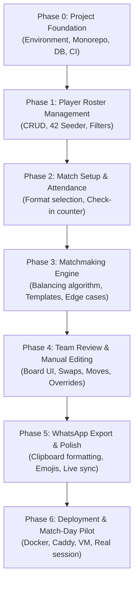

# F4F Application — Phase-Wise Development Roadmap

## 1. Roadmap Overview & Phasing Principles

Development is structured into **7 sequential phases** designed to deliver value incrementally while keeping the feedback loop tight:

---

## 2. Detailed Phase Specifications

### Phase 0 — Project Foundation & Tooling Setup
- **Objective:** Establish the clean monorepo architecture, Go module, Android Gradle build, PostgreSQL container, and local development harness.
- **Features / Deliverables:**
  - Git repository initialization with `.gitignore` and branching policy.
  - Go 1.22+ backend scaffold (`cmd/api`, `internal/`, `go.mod`, `Makefile`).
  - Android Jetpack Compose project scaffold with Material 3 and basic navigation.
  - Docker Compose configuration (`postgres:16-alpine`, healthchecks, volumes).
  - Migration tool setup (`golang-migrate`) and base schema execution.
  - `GET /health` endpoint verifying Go server and DB connectivity.
- **Dependencies:** None.
- **Testing:** Local Docker up verification, `curl /health`, Android blank screen build.
- **Definition of Done:** Both Go backend and Android app compile and run locally; backend connects to PostgreSQL container successfully.
- **Risks & Blockers:** Android SDK environment paths and Gradle build daemon setup.

---

### Phase 1 — Player Roster Management
- **Objective:** Enable the organiser to maintain community players and seed the initial 42-player list.
- **Features / Deliverables:**
  - Player database entity and migrations (`players` table).
  - Go repository, service, and handlers for Player CRUD (`GET`, `POST`, `PATCH`).
  - Seed migration & command populating the 42 corrected players (5 GK, 14 DEF, 14 MID, 9 STR).
  - Android `RosterScreen` with Compose: list of players, position badge colors, active toggle.
  - Search by name and position filter pills (All, GK, DEF, MID, STR).
  - Add/Edit player dialog with position selection.
- **Dependencies:** Phase 0.
- **Testing:** Unit tests for player repo and validation; UI tests for search and position filtering.
- **Definition of Done:** Organiser can view all 42 players, filter by position, add a new player, edit an existing player, and deactivate a player. Changes persist in PostgreSQL.
- **Risks & Blockers:** Accidental duplicate entries; ensure UI warns on similar names.

---

### Phase 2 — Match Creation & Attendance Check-In
- **Objective:** Provide the match-day entry point where the admin creates a session and checks in attending players.
- **Features / Deliverables:**
  - Match and attendance database schema (`matches`, `match_attendees`).
  - Go endpoints: `POST /matches`, `GET /matches/{id}`, `PUT /matches/{id}/attendees`.
  - Android `MatchSetupScreen`: Select format (6v6, 7v7, 9v9), set optional venue/time.
  - Android `AttendanceScreen`: Fast check-in list with checkboxes, search bar, and position badges.
  - Live sticky counter header showing total attendees and position breakdown (e.g. `28 Players selected: 4 GK | 12 DEF | 8 MID | 4 STR`).
  - Quick "Select All" / "Clear All" convenience actions.
- **Dependencies:** Phase 1.
- **Testing:** Verify attendee sync is atomic; verify inactive players are excluded; verify live counters update reactively in Compose.
- **Definition of Done:** Admin can create a match, tick 28 attendees, see accurate live breakdown, and save the attendance list to the database.
- **Risks & Blockers:** Fast multi-tapping leading to race conditions; debouncing and optimistic UI updates needed.

---

### Phase 3 — Team Matchmaking Engine
- **Objective:** Build the core position-balancing algorithm with zero external dependencies and rigorous unit test coverage.
- **Features / Deliverables:**
  - Standalone Go package `internal/matchmaker`.
  - Position templates for 6-a-side (1-2-2-1), 7-a-side (1-3-2-1), and 9-a-side (1-3-3-2).
  - Algorithmic logic:
    1. Validate unique IDs.
    2. Calculate team count based on format and attendee count.
    3. Allocate Keepers first (1 per team).
    4. Allocate outfield positions using relative deficit scoring.
    5. Handle leftovers according to `sub_policy` (`STRICT_SUBSTITUTES` vs `DISTRIBUTE_ALL`).
    6. Run post-generation invariant validation (no duplicates, no omissions).
    7. Generate actionable warnings (e.g. "Keeper shortage on Team 3 & 4").
  - Go endpoint: `POST /api/v1/matches/{id}/generate-teams`.
- **Dependencies:** Phase 2.
- **Testing:** 13 unit test cases covering all edge cases (TC-ENG-01 to TC-ENG-13), zero-allocation invariance, benchmark <5ms.
- **Definition of Done:** Engine produces balanced teams predictably, leaves zero players unaccounted for, flags shortages, and passes all edge-case tests.
- **Risks & Blockers:** Extreme attendee distributions (e.g. 15 Strikers and 1 Defender); engine must degrade gracefully without panicking.

---

### Phase 4 — Team Review & Manual Editing Board
- **Objective:** Give the organiser full visual control to inspect, adjust, swap, and override generated teams.
- **Features / Deliverables:**
  - Database persistence for teams and assignments (`teams`, `team_assignments`).
  - Go endpoints: `GET /matches/{id}/teams`, `POST /assignments/swap`, `POST /assignments/move`.
  - Android `TeamBoardScreen`:
    - Tabbed or paginated view of teams (Team 1, Team 2, Team 3, Team 4).
    - Players grouped by position within each team (with icons: 🧤, 🛡️, ⚙️, ⚡).
    - Dedicated "Substitutes / Bench" tray.
    - Tap-to-swap mechanism (tap Player A on Team 1, tap Player B on Team 2 -> instant swap).
    - "Move to Team" dropdown or quick action sheet.
    - Emergency Keeper assignment action.
    - "Regenerate Teams" button with explicit warning dialog.
- **Dependencies:** Phase 3.
- **Testing:** Verify swaps update DB atomically; verify UI reflects swaps immediately; verify regeneration replaces manual edits safely.
- **Definition of Done:** Organiser can inspect all teams, easily swap any two players, move players to/from bench, and assign an emergency goalkeeper.
- **Risks & Blockers:** Cluttered UI on small screens; use clean cards, position icons, and smooth transitions.

---

### Phase 5 — WhatsApp Export & Match Finalisation
- **Objective:** Enable instant one-tap copy of the finalised team distribution directly into WhatsApp.
- **Features / Deliverables:**
  - WhatsApp text formatter utility (implemented in Go for API export and in Kotlin for instant offline copy).
  - Exact formatting complying with PRD `04`:
    - Bold team headers: `*TEAM 1 (Orange)*`.
    - Grouped lines with emojis: `🧤 Keeper: ...`, `🛡️ Defenders: ...`, `⚙️ Midfielders: ...`, `⚡ Strikers: ...`.
    - Separate `*SUBSTITUTES*` section.
    - Omission of blank metadata (no invented dates or venues).
  - Android `Copy WhatsApp Message` button with tactile haptic feedback and Snackbar confirmation (`"Team distribution copied to clipboard!"`).
  - Optional: Android native Intent share sheet (`ACTION_SEND`) to directly open WhatsApp.
  - Finalise Match action: locks match state from further accidental edits.
- **Dependencies:** Phase 4.
- **Testing:** Verify copied text across WhatsApp Web and Android WhatsApp client; verify special characters, emojis, and multiline formatting render cleanly.
- **Definition of Done:** Organiser can copy the distribution in 1 tap, paste into WhatsApp, and the output matches the exact review screen arrangement.
- **Risks & Blockers:** Inconsistent emoji rendering across different Android OS versions; stick to universal Unicode emojis.

---

### Phase 6 — Deployment, Infrastructure & Match-Day Pilot
- **Objective:** Deploy the backend to a secure Linux server, configure HTTPS, and conduct a live pilot on an actual match day.
- **Features / Deliverables:**
  - Docker Compose production configuration with resource limits.
  - Caddy configuration with automated SSL certificates.
  - Automated database backup script (`pg_dump` with S3/cron sync).
  - Android release APK build (`minifyEnabled`, ProGuard rules).
  - Pilot test execution with 25–40 real players on a Saturday morning.
- **Dependencies:** Phase 5.
- **Testing:** End-to-end rehearsal; network drop resilience test; DB restore test from backup.
- **Definition of Done:** System runs live during an actual match session without crashing or stalling, and organiser shares teams successfully to WhatsApp.
- **Risks & Blockers:** Cold starts or sleep timeouts on free-tier hosting; ensure host remains awake or provision low-cost VPS.

---

### Phase 7 (Future) — Post-MVP Enhancements
- Player self-service accounts (view upcoming matches, declare availability).
- FCM push notifications for match announcements.
- Admin UPI QR code display and manual payment verification (Paid / Unpaid checklist).
- Player appearance history and attendance statistics.
